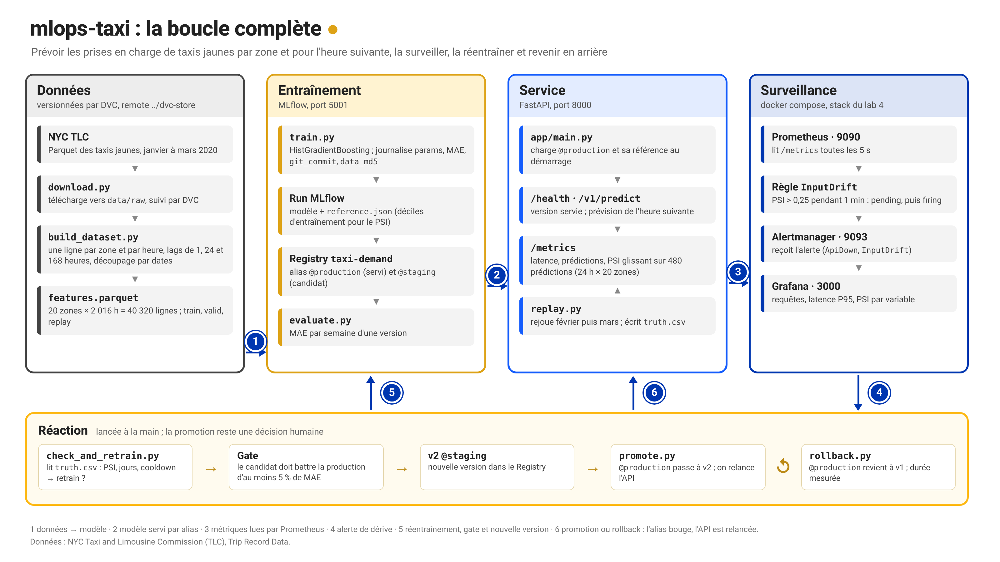

# mlops-taxi : prévoir les prises en charge de taxis jaunes à New York, par zone et pour l'heure suivante (projet MLOps, Albert School)

## But

Prévoir, pour chacune des 20 zones les plus actives de New York, le nombre de prises en charge de taxis jaunes dans l'heure suivante, et garder ce modèle sous contrôle : chaque version est tracée (MLflow et DVC), servie par une API testée, surveillée (Prometheus, Alertmanager, Grafana), réentraînée quand les entrées dérivent, et peut revenir en arrière en moins de 5 minutes. La dérive étudiée est mars 2020 : la demande s'effondre avec le confinement.

## Schéma



Les diapositives de la soutenance sont dans `docs/soutenance.pdf`, le rapport d'incident dans `docs/incident_report.md`.

## Données

Source : NYC Taxi and Limousine Commission (TLC), Trip Record Data, https://www.nyc.gov/site/tlc/about/tlc-trip-record-data.page (taxis jaunes, janvier à mars 2020, un fichier Parquet par mois). Détails des fichiers et des colonnes lues : `docs/data.md`.

Les fichiers bruts ne sont jamais commités : DVC les suit avec le pointeur `data/raw.dvc`.

## Prérequis

- Git, uv (Python 3.12 est installé par uv) et Docker avec Docker Compose.
- Ports libres : 5001 (MLflow), 8000 (API), 9090 (Prometheus), 9093 (Alertmanager), 3000 (Grafana).
- Environ 250 Mo d'espace pour les données brutes.

Toutes les commandes se lancent depuis la racine du dépôt. Elles sont écrites pour macOS et Linux ; sous Windows (PowerShell), remplacer `OMP_NUM_THREADS=1 uv run …` par `$env:OMP_NUM_THREADS=1; uv run …` et `curl` par `curl.exe`.

## Installation

Chaque commande est suivie de la sortie attendue.

```bash
git clone https://github.com/matisdy/mlops-taxi.git && cd mlops-taxi
uv sync --locked
# l'environnement .venv est créé, sans erreur

uv run python download.py
# data/raw/yellow_tripdata_2020-01.parquet: 93.6 MB, downloaded   (puis 2020-02 : 92.1 MB, 2020-03 : 44.4 MB)

uv run dvc add data/raw
# remplit le cache DVC ; ne pas suivre le conseil « git add data/raw.dvc » qu'il affiche
git status --short data/raw.dvc
# rien : mêmes empreintes que le pointeur commité, donc mêmes fichiers

uv run python build_dataset.py
# data/features.parquet: 40320 rows   (puis les colonnes, le nombre de lignes par split et data/zones.json)

uv run pytest -q
# 24 passed
```

Sur la machine qui a le remote DVC local `../dvc-store` à côté du dépôt, `uv run dvc pull` remplace `download.py` et `dvc add` (voir `docs/data.md`).

## Lancement en quatre terminaux

| Terminal | Commande | Sortie attendue |
| --- | --- | --- |
| 1 · MLflow | `uv run mlflow ui --port 5001 --backend-store-uri sqlite:///mlflow.db --artifacts-destination ./mlartifacts` | l'interface répond sur http://127.0.0.1:5001 |
| 4 · entraînement | `uv run python train.py` | `mae_valid 28.4983 \| mae_baseline_valid 47.8886` puis `run_id = <RUN_ID>` |
| 4 · Registry | `uv run python register.py <RUN_ID>` | `taxi-demand v1 is now @production` |
| 2 · API | `OMP_NUM_THREADS=1 uv run uvicorn app.main:app --port 8000` | `loaded models:/taxi-demand@production (version 1)` ; documentation sur http://127.0.0.1:8000/docs |
| 3 · surveillance | `cd monitoring && docker compose up -d && cd ..` | Prometheus http://localhost:9090 (cible `taxi-api` à `UP`), Alertmanager http://localhost:9093, Grafana http://localhost:3000 (sans identifiant) |

Le terminal 4 sert ensuite aux scripts de la démo : `replay.py`, `check_and_retrain.py`, `promote.py` et `rollback.py`.

Vérifier l'API :

```bash
curl -s localhost:8000/health
# {"status":"ok","model_version":"1"}
curl -s -X POST localhost:8000/v1/predict -H 'Content-Type: application/json' -d '{"zone": 237, "ts": "2020-03-02T08:00:00", "lag_1h": 112.0, "lag_24h": 98.0, "lag_168h": 120.0}'
# {"zone":237,"ts":"2020-03-02T08:00:00","prediction":…,"model_version":"1"}
```

## Démo

Le déroulé complet, minute par minute, avec l'état de départ et le plan B, est dans `docs/demo_script.md` ; qui tape quoi et ce qui doit s'afficher, dans `docs/fiche_passage.md`. Les cinq étapes, dans cet ordre (Spécifications §12) :

```bash
# 0. Avant : rejouer février, la période normale (aucune alerte)
uv run python replay.py --start 2020-02-17 --end 2020-02-29
# done: ok …, errors 0, rows appended to data/truth.csv

# 1. Une requête : curl /health puis POST /v1/predict (voir plus haut)

# 2. La dérive : rejouer mars 2020
uv run python replay.py --start 2020-03-01 --end 2020-03-31
# dans Grafana, le PSI dépasse 0,25 ; dans Prometheus (/alerts), InputDrift passe de pending à firing, puis l'alerte arrive dans Alertmanager

# 3. La décision et le réentraînement
uv run python check_and_retrain.py
# {"now": …, "action": "retrain", …} puis taxi-demand v2 is now @staging (MAE … vs … in production)

# 4. La promotion, décidée par une personne
uv run python promote.py
# taxi-demand v2 is now @production (was v1), puis Relancer l'API : relancer le terminal 2 ; /health affiche v2

# 5. Le rollback, chronométré
uv run python rollback.py
# taxi-demand v1 is now @production, puis Relancer l'API : relancer le terminal 2 ; /health shows v1 after … s
```

Pour rejouer la démo depuis le début, repartir d'un Registry vide (`docs/demo_script.md` §1).

## Rollback

La procédure en cinq lignes est dans `docs/runbook.md` : `uv run python rollback.py` remet l'alias `@production` sur la version précédente, puis on relance l'API, qui ne charge le modèle qu'au démarrage. Objectif : moins de 300 s ; mesuré à 22,4 s pendant l'incident (`docs/incident_report.md`).

## Tests

```bash
uv run pytest -q
# 24 passed
```

La CI GitHub Actions (`.github/workflows/ci.yml`) lance `uv sync --locked` puis `uv run pytest -q` à chaque push et à chaque pull request.

## Dépannage

- **macOS** : le port 5000 est pris par AirPlay, d'où MLflow sur le port 5001.
- **Linux** : Prometheus joint l'API de la machine par `host.docker.internal`, grâce à `extra_hosts` dans `monitoring/docker-compose.yml` (déjà en place).
- **`check_and_retrain.py` répond « cooldown »** : un réentraînement de moins de 7 jours figure dans `data/decisions.jsonl`. Pour rejouer la démo, repartir propre (`docs/demo_script.md` §1).

## Hypothèses

- Le groupe compte cinq membres ; chacun commite.
- La dérive injectée est la période de mars 2020, rejouée dans l'API en marche. Le sujet cite mars 2020 comme période de dérive, et le cours décrit le projet avec « a drift period that you inject » (S5 p.33).
- `check_and_retrain.py` est lancé à la main, comme le script unique du lab (S5 p.33) ; l'alerte, elle, se déclenche seule.
- La grille détaillée annoncée par le sujet n'y figure pas : nous suivons ce qui est écrit.

## Membres du groupe

Jérémy Caillaud, Elimane Diallo, Matis Douay, Driss Haddadi et Hugo van Zuylen (Albert School, M2, cours MLOps & Model Deployment, 2026).
